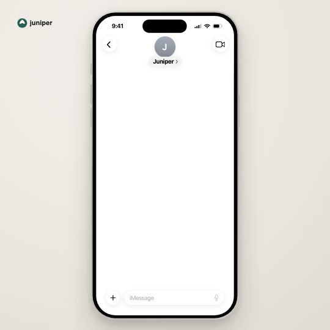

# ClipScript

Write a chat as a plain-text script, get a square animated iMessage-style video. ClipScript renders a 1080×1080 MP4 or a GIF from one text file and one command.



The clip above comes from this script:

```
@contact Juniper

me: need a rain jacket for a trip next week
them: On it. What's the budget?
me: under $200, packable if possible
them: Found one that fits
@camera zoom 1.18
them: [card "Arc Packable Shell" $180 assets/sample-jacket.svg]
@pause 0.6
them: Packs into its own pocket and it's in your size. Want it?
me: yes please
@camera reset
them: Ordered. Arrives Thursday.
```

## Quick start

You need Node.js 22 or newer.

```bash
git clone https://github.com/jaymeh13/clipscript.git
cd clipscript
npm install
npm run make -- "Rain jacket demo"
```

`make` checks the script, then writes three files to `out/`:

- `rain-jacket-demo-sheet.png` — a contact sheet showing the scene after each beat, so you can review the whole video in one image
- `rain-jacket-demo-1080.mp4`
- `rain-jacket-demo-540.gif`

The first render downloads a headless browser for Remotion, so it takes longer than later ones.

## Make your own

1. Save a script as `projects/<Name>.txt`.
2. Run `npm run make -- "<Name>"`.
3. Look at the contact sheet, fix the script, and run it again.

Put images in `public/assets/` and refer to them as `assets/<file>`.

## What a script can do

| Line | What it does |
|---|---|
| `me:` / `them:` | A message. Yours types into the input bar; theirs shows typing dots first. |
| `[card "Title" price image]` | A product card. |
| `[link url "Title" image]` | A rich link preview. |
| `@open url screenshot` | Taps the link and slides a browser view over the chat. |
| `@scroll`, `@photos`, `@swipe` | Scroll the open page and browse photos on it. |
| `@notify text` / `@back` | A message arrives as a banner over the browser; tap it to return. |
| `@react 👍` | A tapback on the latest message. |
| `@camera zoom 1.2` / `@camera reset` | An eased zoom on the phone. |
| `@pause 0.6` | Wait. |
| `{lead 1.2, hold 2}` | Override a line's typing time and the wait after it. |
| `@theme`, `@background`, `@accent`, `@frame`, `@size`, `@logo` | Style for the whole video. |

[CLAUDE.md](CLAUDE.md) is the full reference: every directive and option, the project file format, and a map of the code.

## Commands

| Command | Output |
|---|---|
| `npm run make -- <project>` | Contact sheet, MP4 and GIF |
| `npm run sheet -- <project>` | Contact sheet only, for quick iteration |
| `npm run render -- <project> --format mp4\|gif` | One video file |
| `npm run still -- <project> --at 3.5` | A full frame at a given second |
| `npm run check -- <project>` | Script errors and the timing of every beat, as JSON |
| `npm run capture -- <url>` | A site's preview image, icon and phone screenshot, plus script lines to paste |
| `npm run dev` | The studio UI at http://localhost:5173 |

`capture` needs Chrome, Chromium, Edge or Brave installed.

## Using it with a coding agent

ClipScript is built to be driven from a terminal by an agent such as Claude Code. The agent writes the script, runs `make`, and reads the contact sheet to see what it made. `CLAUDE.md` gives it everything it needs, so you can ask for a video in plain words.

## The studio

`npm run dev` opens a browser editor with a live preview, a storyboard, a timeline and an inspector for style, timing and camera moves. It saves projects as JSON in `projects/`.

## Development

```bash
npm run typecheck
npm test
```

Every frame is a pure function of the script and the frame number. Keep animation frame-driven (`useCurrentFrame()`), never CSS transitions or timers, or exports will not match the preview.

## Licence

ClipScript's own code is released under the [MIT licence](LICENSE).

It is built on [Remotion](https://www.remotion.dev), which has its own licence: free for individuals and small teams, paid for larger companies. Check [Remotion's licence](https://www.remotion.dev/docs/license) before using ClipScript at work.

ClipScript is not affiliated with Apple. iMessage and Safari are trademarks of Apple Inc.
